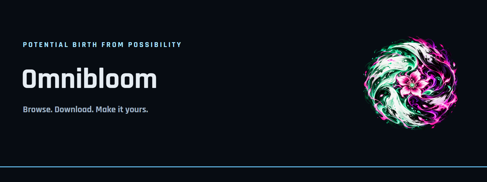

# GitHub presentation

## egomortal/omnibloom

Omnibloom brings Omni, Downloads, Files and Master Control together through Bloom Core, with a PC Setup app.

Start with the installation guide and the release compatibility notes. Do not imply universal firmware, controller or streaming support.

## egomortal/master-control

Pair controllers, review input and choose layouts for your apps. Connection methods and extra features vary by exact controller model.

Use the compatibility table in index.html; replace “Needs release test” only with evidence tied to a version.

## Image inventory

SVG sources and PNG exports: 1600×600 README heroes; 1280×640 social previews. Screenshot sets contain fictional UI sample data only. Do not use mock screenshots to claim console validation.
