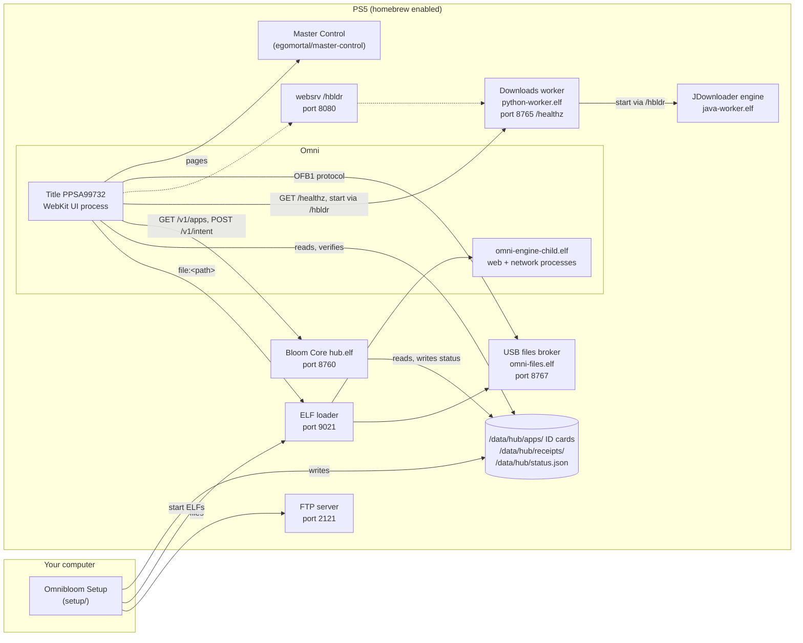

# Architecture overview

Omnibloom is a few small programs on the PS5 plus one desktop app (Setup).
They talk to each other over loopback (`127.0.0.1`) ports and through files in `/data/`.

## The picture



The ports in the picture are the preferred ones. Setup can move an app to another port and writes the
real port into the app's ID card (see [Ports](#ports)).

## The pieces

### Omni (the browser)

Omni is two programs.

1. **The title** `PPSA99732`. It is the WebKit UI process: the window, the controller, the menus.
   It installs to `/data/homebrew/PPSA99732/` (`setup/omnibloom_setup/config.py`, `TITLE_ID`).
   Its sources are `omni/native-title/src/` and the build recipe is `omni/native-title/build.py`.
2. **The engine child** `/data/omni/native/omni-engine-child.elf`. It runs WebKit's web process and
   network process. Its build recipe is `omni/native-title/child_build.py`, and its own sources are in
   `omni/native-title/child-src/`.

The title does not start the child itself. It sends one line, `file:<path>\n`, to the **ELF loader** on
`127.0.0.1:9021`, and the loader starts the ELF (`omni/native-title/src/NativeLauncherState.cpp`, `nativeSpawn`).
When WebKit asks for `/data/omni/omni-engine.elf`, the title swaps in the child path if the child is installed
(`nativeChildPath`, same file).

The title only starts the children in browser mode: it needs `/data/omni/browser-mode.flag` and must not
find `/data/omni/prespawn-disabled.flag` (`omni/native-title/src/OmniNativeTitle.cpp`).

How the title is built: [omni-title-build.md](omni-title-build.md).

### Bloom Core (`hub.elf`)

Bloom Core keeps the list of installed apps and checks that they are healthy.

- Installed at `/data/pldmgr/payloads/BloomCore/hub.elf` and started by Payload Manager's autoload
  (`setup/tools/make_package.py`, the `hub` entry in `APPS`).
- Listens on `127.0.0.1:8760`. This is the only fixed port in the suite
  (`setup/omnibloom_setup/config.py`, `HUB_PORT`; `omni/native-title/child-src/OmniHubCards.h`, `hubPort`).
- Its source (`hub.c`) is **not** in this repository. `setup/tests/fake_console.py` contains a stub that follows
  the same rules, and is the best reference here.

Files Bloom Core uses (`setup/omnibloom_setup/config.py`):

| Path | What it is | Who writes it |
|---|---|---|
| `/data/hub/apps/<id>.json` | **ID card**: id, name, version, kind, port, pages, launch, health. Max 32 KiB. | Setup |
| `/data/hub/receipts/<id>.json` | **Receipt**: what Setup installed and the card's SHA-256. Max 8 KiB. | Setup |
| `/data/hub/receipts/details/<id>.json` | the full file list and the full card | Setup |
| `/data/hub/runtime/<id>.json` | `{id, host, port, pid, started_at}` of a running app | each app at start |
| `/data/hub/status.json` | the health of every app, rewritten about every 10 s | Bloom Core |
| `/data/hub/token` | the token for `POST /v1/intent` | Bloom Core |

A card example (the Downloads card, from `setup/tools/make_package.py`, shortened):

```json
{"hub_api": 1, "id": "downloads", "name": "Omni Downloads", "kind": "service", "port": 8765,
 "launch": {"elf": "/data/omni-downloader/python-worker.elf", "autoload": "never"},
 "health": "/api/health", "pages": {"main": "/"}, "provides": ["download.url"]}
```

The card rules are in `omni/native-title/child-src/OmniHubCards.h` (Omni checks them too):

- `hub_api` must be 1. `id` uses `a-z`, `0-9` and `-`, at most 40 characters, and must match the file name.
- `kind` is `title`, `payload` or `service`. A port must be 1024-65535 and may never be 8760, 9021 or 2121.
- The receipt must have the same `id` and `version` as the card, and its `card_sha256` must match the card file.

How Omni uses Bloom Core (`OmniHubCards.h`):

- Omni reads and checks the cards and receipts **itself**, at most every 5 seconds. So the Apps menu still
  works when Bloom Core is down.
- `liveApps()` calls `GET /v1/apps` for live status.
- "Send to Downloads" calls `POST /v1/intent` with the `download.url` intent and the `X-Hub-Token` header.

### The Downloads worker

A Python service that downloads media. Source: `downloads/worker/`.

- `worker.py` is the HTTP server. `console_worker.py` is the console entry point. It is packaged as
  `/data/omni-downloader/python-worker.elf` (`setup/tools/make_package.py`).
- It listens on `127.0.0.1` only. The port comes from its ID card and must be in 8761-8899
  (`downloads/worker/suite_port.py`). 8765 is the preferred port.
- `GET /healthz` answers exactly `{"service":"omni-media-worker","api_version":1}` (`worker.py`).
  Omni uses this to know the worker is up.
- The `/api/...` calls that change things need the `X-Omni-Token` header. The worker makes a new random token
  each run and puts it into its own page (`worker.py`).
- Omni starts it on demand, not at boot. See [Media downloads](features.md#media-downloads-l1r1).

### The USB files broker

`omni-files.elf` lets Omni read and write USB drives (`/mnt/usb0..7`, `/mnt/ext0..1`), which the title
cannot reach from its sandbox. Source: `omni/files-broker/` (start with the header of `src/omni-files.c`).

- Installed at `/data/omni/native/omni-files.elf`. The title starts it through the ELF loader
  (`omni/engine/entry/OmniFilesBroker.h`).
- It speaks its own small protocol, not HTTP: each request starts `OFB1\t<token>\t<verb>`.
  The verbs are `hello`, `places`, `stat`, `list`, `read`, `write` and `mkdir`. There is no delete.
- It takes its port from its ID card (`src/ofb_port.h`) and stops if the card has none. 8767 is the preferred port.
  Web pages are never allowed to reach it (`OmniHubCards.h`).
- It exits when the title is gone.
- Known gap: Omni's client still uses the fixed port 8767 (`omni/engine/entry/OmniFilesBroker.h`). The change that
  reads the port from the card is in `omni/native-title/patches/clean4/integration.diff`.

### Master Control

Master Control is a separate project with its own repository, **egomortal/master-control**.
This repository only has a pointer (`master-control/README.md`).

- Setup downloads its package from that repository's releases (`setup/omnibloom_setup/config.py`, `SOURCES`)
  and installs `/data/pldmgr/payloads/master-control/master-control.elf`, with autoload optional.
- Its card asks for port 8766, but Master Control 0.4.2 still listens on 8095. Omni allows both
  (`OmniHubCards.h`, `legacyMasterControlPort`; `omni/engine/entry/OmniGamepad.h`).

### The JDownloader engine

An optional download engine. Source: `jdownloader/` (read `jdownloader/README.md` first).

- `java-worker.elf` (`jdownloader/engine/java_worker.cpp`) runs a Java runtime plus a small bridge,
  `jdownloader/java/OmniJDownloaderBridge.java`. The user's own JDownloader 2 files are loaded at run time.
- The Downloads worker starts it when needed (`downloads/worker/jd_lifecycle.py`). It makes a session folder with a
  token, starts the engine through `/hbldr` on port 8080, and waits for a `ready.json` file.
- The bridge listens on a random loopback port and uses a small binary protocol.
- The worker only uses it if its health answer reports `egress_policy: "omni-public-only-v1"`.

### Omnibloom Setup

A desktop app (Windows, macOS, Linux) that installs everything. Source: `setup/`.
It uses the console's FTP server (2121) and ELF loader (9021), writes ID cards and receipts, and edits
`/data/pldmgr/autoload.txt`. Details: [setup-internals.md](setup-internals.md).

## Ports

| Port | Owner | Where it is set |
|---|---|---|
| 2121 | FTP server (ftpsrv) | `setup/omnibloom_setup/config.py` |
| 9021 | ELF loader (elfldr) | `config.py`; `omni/native-title/src/NativeLauncherState.cpp` |
| 8080 | websrv `/hbldr` (starts an ELF with arguments) | `config.py`; `OmniMediaDownloads.h` |
| 8084 | websrv `/processes_list` | `config.py` |
| 8760 | Bloom Core (fixed) | `config.py`; `OmniHubCards.h` |
| 8761-8899 | the range Setup assigns app ports from | `config.py` (`PORT_RANGES`); `downloads/worker/suite_port.py` |
| 8765 | Downloads worker (preferred) | `setup/tools/make_package.py` |
| 8766 | Master Control card (preferred) | `make_package.py` |
| 8767 | USB files broker (preferred) | `make_package.py` |
| 8095 | Master Control 0.4.2 (legacy) | `OmniHubCards.h` |

Setup never hands out a port in `RESERVED_PORTS` (`config.py`).

## Rules that hold everywhere

- **Loopback only.** Services bind to `127.0.0.1`. Web pages cannot reach the ELF loader or the files broker
  (`omni/native-title/child-src/omni-sec-connect.cpp`, `OmniHubCards.h`).
- **Ports come from the ID card.** Do not hard-code a new port. Add it to the app's card in
  `setup/tools/make_package.py` and read it from the card.
- **No user data in logs.** The Downloads worker writes no log at all (`downloads/worker/console_worker.py`).
